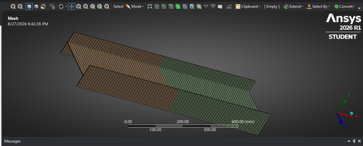
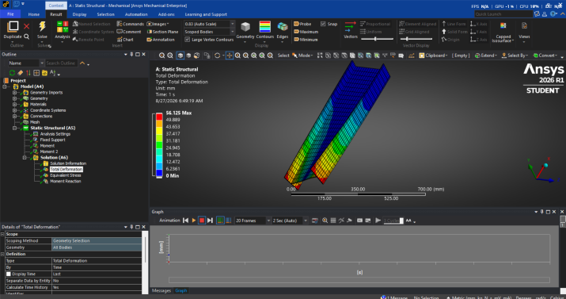
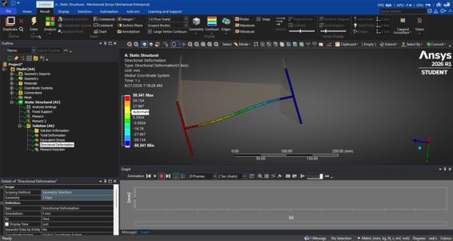
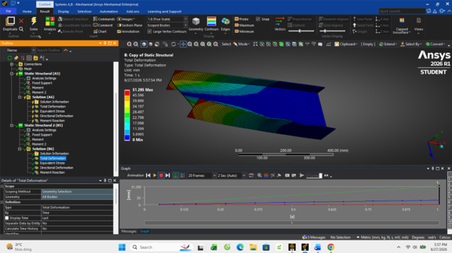
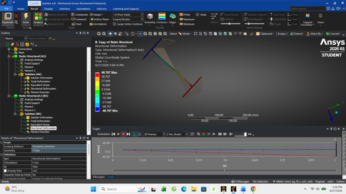
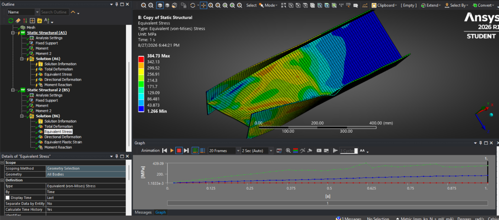
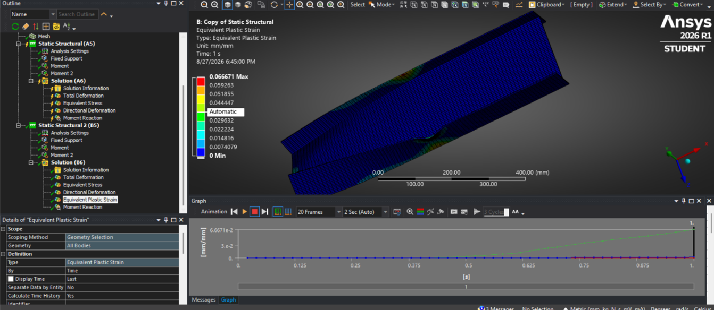
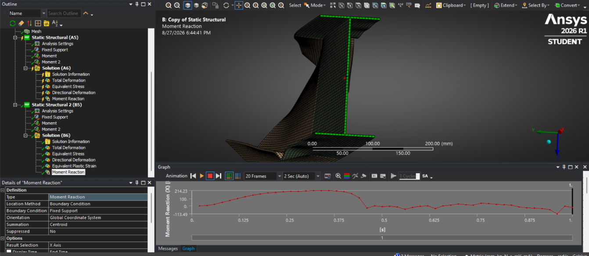

# Thin-Walled I-Beam Torsion Analysis Using ANSYS

## Project Overview

This project focuses on finite element analysis (FEA) of a structural component using ANSYS Mechanical. The objective is to investigate structural behavior under applied loading and evaluate the reliability of numerical simulation results.

## Objectives

- Develop a structural model using ANSYS Workbench.
- Define material properties, boundary conditions, and applied loads.
- Generate a finite element mesh and solve the structural analysis.
- Examine stress and deformation results.
- Compare numerical results with analytical solutions where applicable.

## Software

- ANSYS Workbench 2026 R1
- ANSYS Mechanical

## Project Files

- **Technical Report:** [View Technical Report (PDF)](./K%E1%BA%BFt%20C%E1%BA%A5u%20H%C3%A0ng%20Kh%C3%B4ng.pdf)
- **ANSYS Workbench Project:** [Download Simulation Files (.wbpz)](https://drive.google.com/file/d/1uBZFMIjrbGo5diQqN1BCQNm2amkFDVgs/view?usp=drive_link)
- **Simulation Images:** See the Simulation Gallery below.

## Results and Validation

The report documents the modeling process, simulation results, and engineering analysis. Quantitative findings and validation results should be interpreted with reference to the technical report.
  
## Simulation Gallery

### 1. Geometry

### 2. Finite Element Mesh

### 3. Simulation Results

## Author

Aerospace Engineering student  
VNU University of Engineering and Technology (UET)

---

*This project was developed for engineering learning and technical portfolio purposes.*
